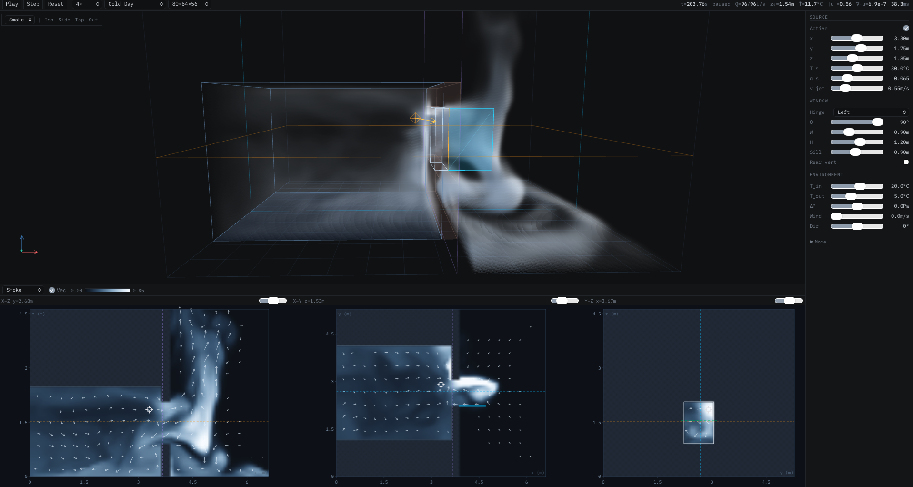

# Window smoke simulation

The simulated fluid dynamics of a moveable source releasing smoke near a window. You can change the window angle, temp parameters, add wind, or open a second vent and watch the exchange change.



## Run it locally

You need an Apple Silicon Mac, Python 3.9 or newer, and Apple Clang. The C solver uses Apple’s threading library and the build targets the M3 processor. If Clang is missing, run `xcode-select --install` and let the installation finish. Use a browser with WebGL2 for the 3D view.

From the repository folder, run the following commands in Terminal.

```sh
python3 -m venv .venv
source .venv/bin/activate
python -m pip install numpy
python -m pycfd.server --grid fast
```

Open [the local viewer](http://127.0.0.1:8080/). The first launch compiles the C solver automatically. Press Ctrl+C in Terminal to stop the server. For later runs, activate the same environment and repeat the last command.


## What the solver computes

The model discretises the room, the window opening, and the air outside.Each cube holds a temperature, pressure, and smoke concentration. The solver stores air velocity on the faces between cubes. Multiplying the speed through a face by its area gives the volume of air crossing it per second. Air can enter or leave at the far edges of the outdoor region, where a damping layer reduces the influence of the artificial boundary.

The smoke field is a relative concentration. The source adds smoke and nudges the nearby air toward the source temperature. With the default settings, a warm plume rises because of that heat. The **Dense Smoke** preset also gives the smoke itself extra weight. The model prescribes a generic source and does not simulate combustion.

### Governing equations

**Airflow.** The solver treats air as incompressible. Each cell must pass on as much air as it receives. Temperature and smoke density affect the vertical force through the Boussinesq approximation.

$$
\nabla \cdot \mathbf{u} = 0
$$

$$
\frac{\partial \mathbf{u}}{\partial t}
+ (\mathbf{u}\cdot\nabla)\mathbf{u}
= -\nabla\phi + \nabla\cdot(2\nu_{\mathrm{eff}}\mathbf{S})
+ g(\beta\theta-\alpha_s c)\,\hat{\mathbf{z}} + \mathbf{f}_{\mathrm{jet}}
$$

Here $\mathbf{u}$ is air velocity. Reading the right-hand side from left to right gives four effects.

- **Pressure** pushes air from high to low pressure. The solver uses the pressure difference from still outdoor air at the same height, divided by a reference density ($\phi$).
- **Friction and mixing** transfer momentum between neighbouring regions. The effective viscosity $\nu_{\mathrm{eff}}$ includes turbulent mixing, and $\mathbf{S}$ is the local rate of strain.
- **Buoyancy** acts vertically. Air warmer than outdoors feels an upward force set by its excess temperature $\theta$ and thermal expansion coefficient $\beta$. Smoke concentration $c$ adds a downward force when its density coefficient $\alpha_s$ is positive. Here $g$ is gravitational acceleration.
- **The optional jet** pushes air near the smoke source in the chosen direction.

**Heat and smoke.** Both travel with the air and spread by mixing. For either field $q$, the solver uses a transport equation with an effective diffusivity $D_q$ and a local source $s_q$.

$$
\frac{\partial q}{\partial t} + \nabla\cdot(\mathbf{u}q)
= \nabla\cdot(D_q\nabla q) + s_q
$$

The emitter adds smoke fastest at its centre. If its local injection rate is $r$, the smoke source is $s_c=r$ and the temperature source is $s_\theta=r(\theta_{\mathrm{source}}-\theta)$. This lets the same emitter warm or cool the surrounding air.

### Numerical choices

- **Conservation.** A finite-volume method computes how much crosses each cell face. A two-stage Runge–Kutta method advances the fields in time. The step size adapts to air speed, diffusion, and buoyancy.
- **Turbulence.** The grid resolves large eddies. A Smagorinsky–Lilly model estimates mixing by smaller eddies and accounts for the effects of nearby walls and vertical density changes. A finer grid captures smaller features and costs more per step.
- **Pressure.** After predicting the velocity, the solver calculates a pressure correction to balance flow in every cell. It uses several grid resolutions to speed up that calculation. The main fields and pressure iteration use double precision, while the multigrid calculations use single precision.

## Use the solver from Python

The browser and Python use the same C solver in `csrc/`. The `pycfd/` package handles compilation, exposes the fields as NumPy arrays, and serves the viewer in `web/`. To get a flow measurement directly, run this in Python from the repository folder with the environment active.

```python
from pycfd import CFD3DSolver

with CFD3DSolver(grid="fast", preset="cold_day") as sim:
    metrics = sim.step_n(50)
    print(f"After {metrics['sim_time']:.2f} s of simulated time:")
    print(f"Outflow {1000 * metrics['q_out']:.1f} L/s")
    print(f"Inflow  {1000 * metrics['q_in']:.1f} L/s")
```

To check the implementation, run `python -m pycfd.verify`. Its eight checks include whether still air stays still, smoke is conserved in a sealed room, the window panel blocks flow, and the direction of exchange reverses between winter and summer.

## Technical Assumptions

- **Boussinesq Approximation**: Density variations are assumed small ($\Delta T / T_0 \ll 1$, $\alpha_s C \ll 1$) so density is constant ($\rho_0$) everywhere except in the vertical buoyancy term. Valid for typical room/outdoor temperature differences and dilute smoke, not for high-temperature fires or dense gas releases.
- **Incompressible Low-Mach Flow**: Acoustic waves are filtered out ($\nabla \cdot \mathbf{u} = 0$); pressure acts instantaneously via the Poisson equation.
- **Dilute Passive/Buoyant Scalar**: Smoke is modeled as a continuous concentration field $C \in [0, 1]$ without particle settling, coagulation, or radiative heat transfer.
- **Adiabatic, Rigid Walls**: Room walls, floor, ceiling, and window sash are perfectly insulated ($\partial_n \theta = 0$) and impermeable ($\mathbf{u}\cdot\mathbf{n} = 0$) with algebraic Werner–Wengle wall shear.
- **Uniform Ambient Exterior**: The outdoor atmosphere is assumed isothermal at $T_{\text{out}}$ with optional steady suburban power-law wind profile, ignoring urban buildings, trees, and gusty turbulence.

## Limitations

- **Grid Resolution & Thin Geometry**: Isotropic cells ($h \approx 5.5\text{–}10\text{ cm}$) resolve room-scale plumes and window exchange well, but cannot resolve thin thermal boundary layers along walls or fine-scale eddies smaller than $h$ (modeled via Smagorinsky–Lilly LES).
- **Staircased / Face-Blocked Angled Sash**: Dual-segment face blocking guarantees zero diagonal leakage across the angled casement sash, but the discrete surface is staircased at cell scale rather than smooth sub-cell cut-cells.
- **Domain Size**: The exterior buffer ($2.5\text{–}2.8\text{ m}$ in $+X$, $0.7\text{–}0.9\text{ m}$ in $\pm Y$, $1.5\text{–}1.9\text{ m}$ in $+Z$) is finite; Dong/Bernoulli OPEN BCs + a 5-cell Rayleigh sponge approximate an infinite atmosphere, but very strong plumes or wide wakes can still experience minor far-field truncation.
- **Single-Room Topology**: Models one rectangular room with one exterior facade and an optional rear vent; multi-room networks or complex furniture are not included.

## Possible Improvements & Why They Were Not Pursued

- **Full Low-Mach Variable-Density Solver** (handling large $\Delta T$ / fire plumes): *Not pursued* because it requires solving a coupled thermodynamic pressure/energy system and variable-coefficient Poisson equation, roughly doubling memory and per-step compute for minimal gain in typical room-ventilation regimes.
- **Cut-Cell / Immersed Boundary Method (IBM)** for smooth sub-cell angled sash & curved geometry: *Not pursued* due to small-cell CFL stiffness and complex MG-PCG operator stenciling; dual-segment face blocking achieves exact zero-leakage impermeability with simple, fast, symmetric stencils.
- **Dynamic Smagorinsky or WALE + Lagrangian Particle Tracking**: *Not pursued* to keep the solver fast enough for interactive real-time 3D execution (~10–30 ms/step on Apple M3); static Smagorinsky–Lilly with Mason–Thomson wall damping and scalar concentration $C$ captures the primary buoyancy physics at a fraction of the cost.
- **Adaptive Mesh Refinement (AMR) / Larger Exterior Domain**: *Not pursued* because uniform structured grids map cleanly to cache-friendly unit-stride C99 loops, ARM64 NEON SIMD, and Geometric Multigrid, fitting within the 8 GB RAM / real-time compute budget.
- **Conjugate Heat Transfer & Solar Radiation**: *Not pursued* as it adds wall-conduction meshes and view-factor radiation solves that are secondary to short-timescale smoke transport.
